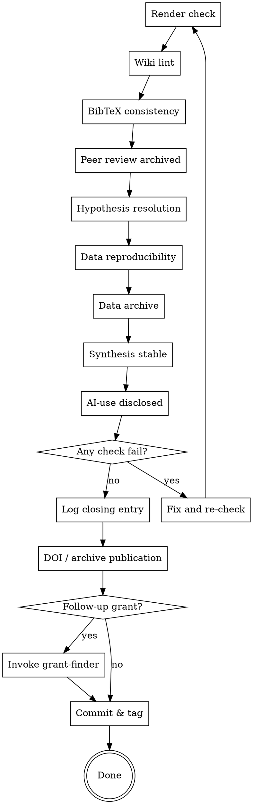

# Finishing a Research Project

The project is done only when the last checklist is green. This skill walks the final mile: rendering, archiving, DOI, submission, and optional grant follow-up.

**Announce at start:** "Using finishing-a-research-project to close out `<slug>`."

<SOFT-GATE>
Before declaring "done", check every item on the Closing Checklist below.

For unmet items: tell the user which, ask for a short reason per skipped item,
write reasons into `knowledge/_meta/gate-overrides.log`, and mark the project
in the log as either `status: done` (with documented omissions) or
`status: paused`. Hidden partial completion is not closure — explicit
justification is.
</SOFT-GATE>

## Closing Checklist

1. **Manuscript renders cleanly** — `make render` in `output/<book|article>/` exits 0; PDF/HTML opens without warnings
2. **Wiki lint green** — `python scripts/lint-wiki.py` exits 0
3. **BibTeX consistent** — every citation key in the manuscript exists in `references.bib`; no unused keys (or unused are intentional)
4. **Peer review done** — both constructive and adversarial reviewer reports archived under `output/<target>/reviews/`; all Major issues resolved or explicitly deferred with rationale
5. **Hypothesis addressed** — pre-registered Hypothesis is explicitly confirmed, refuted, or marked "inconclusive — exploratory" in the manuscript
6. **Data reproducibility** — `output/data-analysis/` has `requirements.txt` or `environment.yml`; a README says "run `python main.py` to reproduce"; seeds are fixed
7. **Data archive** — raw datasets in `input/data/` are licensed; derivatives in `output/data-analysis/results/` are documented
8. **Synthesis stable** — all `knowledge/synthesis/*.md` referenced by the manuscript have `status: stable`
9. **AI-use disclosed** — the manuscript (or its front matter / supplement) carries an AI-use statement in the form the target venue requires, drafted from the project's own records (see [AI-Use Disclosure](#ai-use-disclosure)) and confirmed by the user
10. **Log closing entry** in `knowledge/_meta/log.md`:
   ```
   - YYYY-MM-DD · finish · <slug> · output=<path>
   ```
11. **Publication archive (DOI)** — offer to deposit on Zenodo (or institution repository); update the log with DOI
12. **Decision: submission / follow-up** — journal / publisher / conference? grant renewal?
13. **If follow-up grant:** route to `grant-finder`
14. **If done done:** commit everything (`git add . && git commit -m "finish: <slug>"`), tag the release

## Process Flow



## AI-Use Disclosure

Authorship stays with the humans: an AI system cannot be an author, because
authorship presupposes accountability (DFG statement on generative models, 2023).
What good scientific practice asks for instead is **transparency proportionate to
the use** — which tools did which kinds of work, and that the authors checked the
result and carry responsibility for it (Buck 2026, ch. 3.4). A full prompt log is
*not* the standard: in a workflow where the model touches many steps, single
prompts are no longer attributable to single passages, and the venue rarely asks
for them.

**Binding rules come first.** Read the `## AI-Use Rules` section of
`input/ideas/<slug>-design.md` (recorded during `brainstorming-research`). If it
is missing, ask the user once: which publisher / journal / university / funder
rules apply, and which form do they require? Their rules override this template.

**Draft from the record, not from memory.** The project already documents what
the model did:

- `knowledge/_meta/log.md` — every ingest, synthesis, draft, review pass, with date
- frontmatter `author: human | llm | mixed` on wiki pages, and `based_on:` on substitute sources
- `output/<target>/outline/*.md` — which sections went through the drafting stages
- `output/<target>/reviews/` — the AI review passes and the user's decisions on them
- `knowledge/_meta/gate-overrides.log` — where a gate was skipped (e.g. a straight-run draft)

Summarise by **task**, not by prompt: literature search, source acquisition,
source extraction (ingest), synthesis, drafting, internal review, language
editing. Name the model(s) and the host (Claude Code / OpenCode, provider). State
what the humans did: chose the question and the thesis, read the sources the
argument rests on, approved each argument and section, revised the prose.

**Pick the form the venue wants** — default to (a) if nothing is specified:

(a) **Statement in the manuscript** (acknowledgements, a footnote, or a section
before the references):

```markdown
## Use of AI tools

In preparing this <article / chapter / book>, <model, e.g. Claude Opus 5.5>
was used via <host> for: <literature search in <databases>>; <extracting
claims from sources into a project wiki, with page references>; <drafting
sections from an outline whose thesis and argument the author set and
approved section by section>; <internal review of the draft>. All sources
cited were checked against the original publications. The author(s)
reviewed and revised all AI-assisted content and take full responsibility
for the text.
```

(b) **Tool overview page** at the front of a thesis / dissertation: a table
*task → tool/model → purpose → how the output was checked*.

(c) **AI Usage Card** (Wahle et al. 2023) as an appendix — a semi-standardised
questionnaire; offer it for dissertations and where the institution asks for
detailed documentation.

Present the draft, let the user correct it, and write the final text where the
venue expects it. Do **not** cite the model as a source in the references — AI
output is cited only where it is itself the object of study.

## Reproducibility Statement Template

Drop into the manuscript (or supplementary material):

```markdown
## Reproducibility

All analyses are reproducible from `output/data-analysis/`:

- **Code:** <files>
- **Data inputs:** `input/data/<files>` (licenses: <list>)
- **Environment:** Python <version>, see `output/data-analysis/requirements.txt`
- **Entry point:** `python output/data-analysis/main.py`
- **Random seed:** <fixed value>
- **Repository:** <git URL or Zenodo DOI>
```

## Archive / DOI

Options:

- **Zenodo** — free, accepts datasets + code + manuscripts; gives DOI immediately
- **Institutional repository** — university OA repository
- **GitHub Release + Zenodo-GitHub integration** — tag release, Zenodo creates DOI automatically

Pick one with user, update log entry with DOI.

## Submission Handoff

If submission targeted:

- Identify journal / publisher / conference CfP
- Check author guidelines — may require format conversion (`quarto render --to docx` / `--to latex`, or pandoc)
- Produce cover letter draft
- Confirm corresponding author + ORCID
- Do NOT submit on the user's behalf — prepare and hand over

## Red Flags

| Thought | Reality |
|---------|----------|
| "Wiki-lint is just a detail, I'll skip it" | Broken wikilinks are the #1 reviewer feedback point. |
| "The hypothesis was wrong, I'll just reword it" | Pre-registration principle: document honestly. The result is what it is. |
| "I'll do the Zenodo DOI later" | Later = never. Now, or explicitly into the log. |
| "Follow-up grants are separate projects" | Now is the best moment — the story is fresh in your head. |
| "It's just a working paper, not a publication" | Even unpublished work must be reproducibly archived. |
| "AI use is obvious from the workflow, no need to state it" | Readers and examiners cannot see the workflow. Undisclosed AI-generated text is a breach of good scientific practice, and most venues now require a statement. |
| "I'll attach the full prompt history to be safe" | Not attributable in a multi-step workflow and rarely required. Disclose by task, in the form the venue asks for. |

## Key Principles

- **The checklist is the closure** — not "feels done"
- **Hypothesis honesty** — what was predicted, what came out, what's open
- **Reproducibility** — manuscript AND data AND code AND environment
- **AI use is disclosed, authorship is not shared** — proportionate, task-level transparency; the humans are the authors and carry the responsibility
- **DOI before submission** — an archived version exists before the publisher process
- **Log entry is the final artefact** — the project is closed in the log
