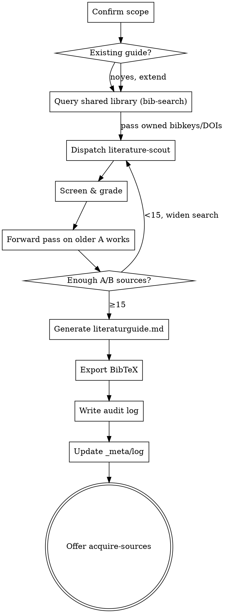

## Boundary: literature-review → acquire-sources → ingest-source

`literature-review` runs SEARCH — discovers candidate sources, grades them, builds a strategic guide, produces BibTeX entries. Outputs land in `input/bibliography/`. **It downloads no PDFs and creates no `knowledge/sources/*.md`.** It records each candidate's `oa_pdf` / DOI so the next phase can fetch it. **It searches the shared library *first*** (step 3) — the master bibliography grows with every project, so a new question increasingly overlaps sources you already own, and those cost nothing to "acquire".

`acquire-sources` runs ACQUISITION — auto-downloads the Open-Access PDFs for the A+B set into `input/bibliography/` and writes `acquisition-todo.md`, a manual-download worklist for everything paywalled or bot-blocked.

`ingest-source` runs INTAKE — takes ONE already-acquired source PDF and produces the wiki content (Source page, entities, BibTeX entry, log line).

The three skills are sequential, not overlapping. A typical session: literature-review once → acquire-sources once (re-run to reconcile) → ingest-source N times.

# Literature Review (Superpowers-Wrapper)

This skill wraps the detailed workflow of `research-skills/dao-literature-review` (OpenAlex, IxTheo, Zenon-DAI, Propylaeum, Persée, OpenEdition, CORE, arXiv, DNB) with the research-superpowers discipline: checklist, SOFT-GATE against rushing, red-flags against "I have enough sources."

**Announce at start:** "Using literature-review to build a strategic literature guide for this project."

<SOFT-GATE>
Before closing the literature phase, check:
(1) ≥ 15 distinct, discipline-appropriate sources are catalogued
(2) `literaturguide.md` exists in `input/bibliography/` and opens with the **weighted source table** (columns `Grade | Autor Jahr | Kurztitel | OA/Zugang | DOI/Link`)
(3) `output/bibtex/references.bib` is updated
(4) `knowledge/_meta/log.md` has a new entry
(5) the **forward pass** ran for every A-graded work that is not among the newest in the corpus, and the guide records its outcome per work — responses found, or none found (see "The forward pass" below)

The threshold of 15 is a rule of thumb for a viable research base, not magic —
a tightly bounded niche topic justifies an undershoot, and a broad debate
demands more. If a condition is unmet: tell the user which, ask for a brief
reason (e.g. "narrow topic with small source corpus"), write it into
`knowledge/_meta/gate-overrides.log`, and close.
</SOFT-GATE>

## When to use

- User asks for a literature review, state of the field, *Forschungsstand*, "what has been written on X?"
- Design doc is approved and tasks in the research plan reference uningested sources
- Before drafting a *Forschungsstand* / state-of-the-field chapter — the chapter pulls from the literature guide

**NOT for:** single-paper lookups (direct metadata query), ingesting a source you already have (use `ingest-source`).

## Checklist

1. **Confirm scope with user** — field, time range, languages, geographic constraints
2. **Check for existing `literaturguide.md`** in `input/bibliography/` — if it exists, offer to extend rather than redo
3. **Query the shared library FIRST** — before any external database, run `python scripts/bib-search.py "<terms>"` over the master library. The library grows with every project, so a new question increasingly overlaps sources you already own — and an owned source needs no acquisition. Two rules make this pay:
   - **Search for the concept, not one string.** Enumerate the method's aliases, spelling variants and word stems and `OR` them into the query, and run it in every language the library holds — a German query does not reach an English source — the same discipline as `drafting-manuscript` → "Searching for a concept, not a string". `bib-search` also matches each source's **curated keywords**, which catch papers that describe a method in prose without ever naming it — exactly the sources a title/abstract search misses.
   - **Aggregate, then screen.** `bib-search` returns page-level hits; collapse them by `bibkey` to get the distinct works, then read the snippets and keep only those genuinely on-topic (a stray word match is not a source). Each kept work goes into the weighted table with **`OA/Zugang = ● Bibliothek`** (already owned, no acquisition), and its `bibkey` + DOI is passed to the scout in step 4 so the external search fills the gap instead of rediscovering it.
4. **Dispatch `literature-scout` subagent** (see `agents/literature-scout.md`) for database queries. **Pass the step-3 `bibkey`/DOI list** as "already in the library" so the scout dedupes against it and spends its budget on what you *don't* have.
5. **Screen results** — titles first, then abstracts. Grade by relevance (A/B/C). Minimum 15 A/B sources before proceeding (library hits count toward the total).
   - **Forward pass (5a)** — a topic search finds what was written *about* the question, not what was written *in reply to* a given work, and not the same author's later word on it. For every A-graded work that is not among the newest in the corpus, run `python scripts/forward-search.py <bibkey-or-doi> --author` and screen what comes back (see "The forward pass" below). Add the replies and later statements that bear on the question to the table, graded like any other candidate; record the outcome per work in the guide.
6. **Generate `literaturguide.md`** — it **opens with the weighted source table** (required; columns `Grade | Autor Jahr | Kurztitel | OA/Zugang | DOI/Link` — see "The weighted source table" below), followed by the 9 prose sections (research question, primary sources, debates, methods, open access, gaps, recommended reading order, follow-up searches, BibTeX overview) — the **debates** section is written in the order things were published and carries the forward-pass block (see "The forward pass"); prose layout per the canonical example (see "Reference Content"). Carry each candidate's `oa_pdf` / DOI into the table for the acquisition phase; **do not download here.**
7. **Export BibTeX** → merge into `output/bibtex/references.bib` (resolve key conflicts with user before merging)
8. **Write audit log** → `input/bibliography/audit-log-<date>.json` — include the forward pass: per work the `forward-search.py --json` result (or "manual"), and which candidates were kept
9. **Update `knowledge/_meta/log.md`** with date, query, result count, guide path
10. **Transition:** offer to run `acquire-sources` on the A+B set — it auto-downloads the Open-Access PDFs and writes a manual-download worklist (`acquisition-todo.md`) for the rest; then `ingest-source` per acquired source. The `● Bibliothek` sources are already present, so `acquire-sources` skips them.

## Process Flow



## The weighted source table (required — section 1 of the guide)

`literaturguide.md` **opens with one graded master table** so the reader sees the
whole weighted corpus at a glance and `acquire-sources` can read the weighting
deterministically. The columns are fixed:

```markdown
## 1. Quellentabelle (gewichtet)

| Grade | Autor Jahr | Kurztitel | OA/Zugang | DOI/Link |
|-------|------------|-----------|-----------|----------|
| A | Finkelstein 2003 | low-chronology | ✓ OA | [10.1179/…](https://doi.org/10.1179/…) |
| A | Mazar 2005 | chronology-debate | ◐ UB | [10.…](https://doi.org/10.…) |
| B | Finkelstein & Piasetzky 2011 | gap-narrowing | ✓ OA | [10.5615/…](https://doi.org/10.5615/…) |
| C | Kenyon 1957 | digging-up-jericho | ○ Fernleihe | — |

Legende — **Grade:** A core/must-read · B supporting · C peripheral/context.
**OA/Zugang:** ● Bibliothek (already in the shared library — no acquisition) · ✓ OA (auto-downloadable) · ◐ UB (university licence) · ○ Fernleihe (ILL/paywalled, manual) · ✗ (no copy located).
```

Column rules:

- **Grade** — relevance to *this project's* research question: **A** must-read /
  core, **B** important / supporting, **C** peripheral / context. Sort A → B → C,
  then by year. This is the column `acquire-sources` filters on (`grade_scope`,
  default `A,B`).
- **Autor Jahr** — first author's surname + year, matching the `autor-jahr` wiki
  slug / bibkey (letter suffix for clashes: `Mazar 2011b`).
- **Kurztitel** — the **same** short title used in the PDF filename
  `autor-jahr-kurztitel.pdf` (one to three significant words, hyphen-joined,
  lowercase). Keeps table row, downloaded file, and wiki page in lockstep.
- **OA/Zugang** — access route, drives acquisition routing: `● Bibliothek` already
  owned (step 3 found it — `acquire-sources` skips it), `✓ OA` auto-download,
  `◐ UB` / `○ Fernleihe` → manual worklist, `✗` → no copy located yet.
- **DOI/Link** — a clickable DOI (preferred) or landing / OA-PDF URL; `—` if none.

The 9 prose sections (reading order, debates, methods, gaps, full bibliography,
audit log) follow the table and add the qualitative depth. This table — not the
prose-only canonical example — is the binding spec for the weighting; if the
example shows an ungraded list, the table here takes precedence and is prepended.

## The forward pass

Two sources in a corpus are not two equal voices: one was written knowing the other.
A search by topic cannot see that. It returned a 2020 article in one live project
while the chapter answering that position cited the author's 2022 restatement — which
was in the library and had never been looked at. The forward pass closes that gap.

**Which works.** Every A-graded work that is not among the newest in the corpus. A
work from the last two or three years has had no time to be answered; a work from
1999 that the whole argument leans on has. B-graded works when a debate turns on them.

**How.** `python scripts/forward-search.py <bibkey-or-doi> [...] --author`. For each
work it lists:

| List | Source | Tells you |
|---|---|---|
| Cited by | OpenAlex (`cites:`) | later works that cite it, newest first; `●` marks the ones already in a `.bib` |
| Named in works you own | the library's full-text index | owned works whose text names it, with PDF pages to open |
| Later works by the author | OpenAlex (`--author`) | everything the first author published since — all topics |

**Screening what comes back.** The lists are candidates, not findings.

- From **Cited by**, keep works on this question; a citation in passing is not a reply.
  Add them to the weighted table and grade them like any other candidate.
- **Named in works you own** costs nothing to check: open the PDF at the page given
  and read the sentence. This is where replies in monographs and edited volumes turn
  up, which OpenAlex mostly lacks.
- From **Later works by the author**, pick the ones on this question. A later
  statement by the same author is the first place a changed mind shows — and when the
  author restates the position instead, that later statement is the one the debate
  answers.

**Neither list is complete.** OpenAlex's citation data is thin for monographs and
edited volumes: on one checked case it listed 39 citing records and missed two
chapters that demonstrably cite the work. The library index knows only what you own.
Write "none found", never "unanswered".

**In the guide.** The debates section follows publication order, and closes with one
block per work the pass ran on:

```markdown
### Verlauf: Bartlett 1999 — Edomites and Idumaeans
- Antworten: Levin 2020 (widerspricht, Anm. 34) · Bienkowski 2025 (setzt eine andere
  Deutung dagegen, S. 146) · Marciak 2026 (noch nicht gesichtet)
- Spätere Äußerung des Autors zur Frage: keine gefunden
- Forward pass: OpenAlex 11 Werke, Bibliothek 36 Treffer, 2026-11-10
```

Say what each reply *does* only as far as you have read it; "noch nicht gesichtet" is
an honest entry. The typed relation (`responds-to` / `supersedes` / `revises`) is
written at ingest, from the text — not here, from a citation list.

**Without the script** (no Python, no network): the same three questions by hand —
OpenAlex `https://api.openalex.org/works?filter=cites:<work-id>&sort=publication_date:desc`,
`bib-search.py '"<Surname> <year>"'`, and the author's publication list. Record that
the pass was manual.

## Reference Content

The full API reference, query templates, and the 9-section prose layout of
literaturguide.md live in the original skill at:
`/Users/patrick/Documents/Aktuell/AI-Tooling/research-workflow/research-skills/dao-literature-review/`

Key files:
- `SKILL.md` — full workflow (English/German, all databases)
- `reference.md` — API call examples for OpenAlex, Crossref, Unpaywall, CORE, S2, arXiv, IxTheo, Zenon-DAI, etc.
- `examples/literaturguide-example.md` — canonical output format

A subagent dispatched via `agents/literature-scout.md` inherits this reference material without polluting the main conversation.

## MCP Optimisation (recommended)

> If `dao-paper-search-mcp` (see [`docs/recommended-mcps.md`](../../docs/recommended-mcps.md)) is available in the project, use the MCP tools instead of the manual API calls above — they return structurally verified citation blocks (`inline_citation.markdown`, `authoritative_bibliography_line`) and prevent Author-Year hallucinations. Otherwise stay on the manual path.

Routing by source bucket:

| Bucket | MCP tools |
|---|---|
| DAO / Levant archaeology | `search_zenon`, `search_iaa`, `search_adaj` |
| Cross-platform (academic) | `search_openalex`, `search_crossref`, `search_semantic_scholar`, `search_arxiv`, `search_core`, `search_zenodo`, `search_biorxiv` |
| Theology / ancient studies | `search_ixtheo`, `search_propylaeum`, `search_openedition`, `search_gnomon` |
| Author / place disambiguation | `resolve_author` (Wikidata + GND), `resolve_site` (iDAI.gazetteer) |

When using MCPs, paste `inline_citation.authoritative_bibliography_line` verbatim into the BibTeX export step and feed `audit.source_class` / `audit.warn_marker` into the A/B/C grading (aggregator → downgrade to C, suspect → exclude entirely).

## Red Flags (rationalisations)

| Thought | Reality |
|---------|----------|
| "15 sources are enough for now" | 15 is the MINIMUM, not the goal. |
| "English-only is faster" | German and French scholarship goes missing systematically. |
| "I'll search for the people who work on this" | An author-targeted query finds the people you already know, and the corpus then reproduces your reading list. Query the **method**, not the surname. Replacing three author queries with method-term queries in one review took a corpus from 15 to 27. |
| "One term is enough, it's the standard name" | It is the standard name *in your discipline*. Spelling variants alone decide hits: on a real library `"random labelling"` and `"random labeling"` each found a paper the other missed. |
| "Straight to OpenAlex" | Query the shared library first (step 3). With hundreds of sources already collected, a new question overlaps what you own — and an owned source needs no acquisition. Skipping the local pass re-finds and re-downloads what is already on disk. |
| "I already know the debate" | Knowing it doesn't replace a documented search — reproducibility. |
| "The topic search already found the debate" | It found what is *about* the question. Replies to a specific work, and the author's own later word, come from the forward pass — a 2022 restatement sat unread in the library of a project whose wiki argued against the 2020 version. |
| "OpenAlex lists no citing works, so nobody answered" | OpenAlex is thin on monographs and edited volumes, where much of this field replies. Check the library's full text, and write "none found". |
| "The audit log is bureaucracy" | Without it the search isn't replicable. |
| "Let me just download the PDFs while I'm here" | Not in this skill — search is download-free now. Record each `oa_pdf`/DOI; `acquire-sources` does the fetching. |

## Key Principles

- **Library first, then the world** — `bib-search` the master library before any external database; the growing shared corpus means a new question increasingly overlaps sources you already own, and those need no acquisition. Feed the owned bibkeys/DOIs to the scout so it fills the gap, not the overlap.
- **Strategic guide, not a paper dump** — structure reading order, debates, gaps
- **Query the method, not the author** — and give each method every name it has: the other disciplines' term for it, the US and UK spelling, the German/French form. A method is renamed by everyone who borrows it, so a single-term query measures your own vocabulary rather than the field's. **Record which term produced which hit** — that is a finding about the field, not search bookkeeping.
- **German + English + French where the field demands** — discipline-specific
- **Forward, not only sideways** — for the works the argument leans on, ask who answered them and what their author said next; a corpus without that shows positions, not a debate
- **OA-first metadata** — record each candidate's `oa_pdf`/DOI; `acquire-sources` does the downloading
- **Transparency** — audit log is a mandatory output
- **Keep the handoff open** — the A+B set flows into `acquire-sources` next, then `ingest-source`
