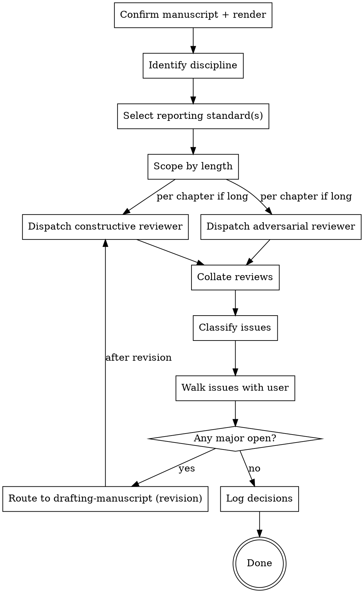

# Requesting Peer Review

Subject a drafted manuscript to structured review before submission. Two passes: **constructive** (strengthen the argument, improve clarity) and **adversarial** (find holes, challenge assumptions). Each pass is a fresh subagent with the manuscript and relevant sources — no conversation history pollution.

**Announce at start:** "Using requesting-peer-review on <manuscript path>."

<SOFT-GATE>
Before closing out the review, check:
(1) Both passes (constructive + adversarial) have produced written reports
(2) The user has decided on every Major Issue: accept / reject / defer

If unmet: explain to the user which condition is missing, ask for a short
reason, write it to `knowledge/_meta/gate-overrides.log`, and close out.
Closing a review with open Major Issues is a deliberate decision, not an
oversight — the reason in the log makes that traceable.
</SOFT-GATE>

## When to use

- A manuscript QMD file exists under `output/` and has rendered successfully
- Before sending to an external reviewer, before submission, before grant deadline
- After major revision, to re-check whether open issues were addressed

**NOT for:** first-draft feedback (use `drafting-manuscript`'s architecture and per-section stops), copy-editing (separate task), single-paragraph checks.

## Checklist

1. **Confirm target manuscript** and render status (`make render` must succeed)
2. **Identify discipline** — Theologie, Biblische Archäologie, Alte Geschichte, Digital Humanities, Mixed Methods — each has specific review criteria
3. **Select reporting standard** — CONSORT (RCT), STROBE (observational), MRC Framework (complex interventions), PRISMA (systematic review), ARRIVE (animal), TRIPOD (prediction models); **discipline-specific:** stratigraphic documentation (archaeology), Formkritik/Quellenkritik (theology), source criticism (DH)
4. **Scope the dispatches by length** — see [Review scope](#review-scope). An article or a single chapter is reviewed whole; a book or any manuscript over ~12,000 words is reviewed **per chapter** (one constructive and one adversarial dispatch per chapter) plus one **structure pass** over the whole. Long inputs measurably weaken model judgement of argument; a review of 80,000 words at once is a review of the first and last chapters
5. **Dispatch constructive reviewer subagent** (see `agents/peer-reviewer.md`) with role `constructive`
6. **Dispatch adversarial reviewer subagent** (fresh context) with role `adversarial`
7. **Collate reviews** into a single `output/<target>/reviews/<date>-review.md` document
8. **Classify each issue:** Major / Minor / Editorial / Out-of-scope. Keep the reviewer's `[confirm with subject expert]` tag on the issue — it travels into the walk-through
9. **Walk the user through each Major and Minor** — decision: accept → revise, reject (with rationale), defer (with log). An issue tagged `[confirm with subject expert]` is a model's claim about the field, not a finding: the user decides whether they can confirm it from their own expertise or whether it goes to a human colleague first. Present the two sections *Missing voices* and *What this review could not check* as well — they are where the review is honest about its own reach
10. **Log decisions** in `knowledge/_meta/log.md`, one line per pass, in this exact shape — `lint-wiki.py`'s `HALF-REVIEW` gate reads it, and an unlogged pass is an unverifiable claim that the review happened:
   ```
   ## [YYYY-MM-DD] review | constructive | <one-line verdict>
   ## [YYYY-MM-DD] review | adversarial | <one-line verdict>
   ```
   If a pass is **skipped**, log it anyway with the deciding reason (`review | adversarial | SKIPPED — <reason>, decided by <who>`). The gate then still reports the gap, which is correct: the manuscript went out on half a review, and the record should say so.
11. **If accepted issues → revisions needed:** route back to `drafting-manuscript` with issue list

## Process Flow



## Review scope

| Manuscript | Dispatches |
|---|---|
| Article, single chapter, grant narrative (≲ 12,000 words) | 1 constructive + 1 adversarial, whole text |
| Book, thesis, or longer manuscript | per chapter: 1 constructive + 1 adversarial; then **1 structure pass** over the whole |

The **structure pass** (role `constructive`, fresh context) does not reread every
chapter. It receives the introduction, the conclusion, the outline files with
their claim chains and section reverse outlines (`output/<target>/outline/*.md`,
written by `drafting-manuscript`), and the chapter-level review summaries. It
asks only global questions: does the book's thesis survive the sequence of
chapters, are any chapters doing the same job, does the conclusion answer what
the introduction asks, is a key term used in two senses across chapters?

Collate per-chapter reports under one dated review document with a section per
chapter. Log **one line per role** as before (the `HALF-REVIEW` gate reads
that), naming the chapters covered in the verdict — e.g.
`## [2026-11-13] review | adversarial | ch. 1–6 + structure; 4 Major (ch. 3, 5)`.

## Reviewer Assignment

Two subagents, FRESH context each:

**Constructive reviewer** (`agents/peer-reviewer.md`, role: constructive):
- Goal: improve the argument, clarify, strengthen
- Tone: supportive senior colleague
- Prompts: "Where is the argument weakest but most important?" "What evidence would strengthen Claim X?" "What does the reader need that isn't here?"

**Adversarial reviewer** (same skill, role: adversarial):
- Goal: find holes, challenge interpretations, flag methodological gaps
- Tone: rigorous external reviewer (Reviewer 2)
- Prompts: "Which claim is inadequately supported?" "What alternative explanation isn't addressed?" "Which sources are missing?" "Is the statistical/stratigraphic/philological method defensible?"

**Dispatch prompts are neutral.** A model's verdict follows the prompt more than
the text: the same essay, framed three different ways, is graded anywhere from
good to failing. So the dispatch states the role, the materials and the
template — and nothing about how good the manuscript is, how much work went
into it, what the author hopes to hear, or how close the deadline is. No
scores, grades or acceptance probabilities are asked for; the review's output is
issues with locations and reasons. The adversarial role is a *way of reading*
(look for the weakest link), not a presumption that the text is weak.

Both subagents receive:
- The manuscript file
- The relevant synthesis and source pages (paths listed)
- The selected reporting standard(s)
- The research plan's Hypothesis + Falsification Criteria
- A blank structured template for their report

## Review Report Template

Saved to `output/<target>/reviews/<YYYY-MM-DD>-<role>-review.md`:

```markdown
---
title: "<Role> Review — <Manuscript>"
reviewer: <subagent-id>
role: constructive | adversarial
date: YYYY-MM-DD
manuscript: <path>
reporting_standard: <CONSORT|STROBE|...|discipline-specific>
---

## Summary
<2–3 sentences: overall impression>

## Major Issues
1. **<Issue>** — <why it matters, where it lives (section/line), suggested resolution>. Tag `[confirm with subject expert]` when the issue rests on a claim about the field's facts (a date, a reading, a find, what the literature holds) rather than on the manuscript's own logic or its cited sources
...

## Minor Issues
...

## Editorial
(typos, unclear phrasing, citation format)

## Methodological Assessment
<assessment against the selected reporting standard>

## Missing Voices
Which schools, positions, language areas or kinds of evidence does the argument
not engage that a specialist reader would expect? (E.g. German- or
French-language scholarship, Israeli excavation reports, a rival dating model,
epigraphic or iconographic evidence.) Model-assisted research leans towards the
most-cited, recent, English-language mainstream — name what that bias would
have hidden here. "None identified" only after checking.

## What This Review Could Not Check
Be explicit about the review's own reach: claims that need first-hand knowledge
of a site, a collection, unpublished material or a language you cannot verify;
sources you could not open; technical judgements (statistics, stratigraphy,
textual criticism) where your assessment is a plausibility check, not an expert
verdict. A reader of this review should know which of its silences mean
"checked, fine" and which mean "not checkable here".

## Falsification Test
Quantitative/mixed: does the manuscript honestly engage with the pre-registered falsification criteria? Hermeneutic: does it state what evidence or reading would refute its thesis, and engage it? If no, flag.
```

## Critical Thinking — Evidence Audit for Reviewers

Both reviewer roles (constructive and adversarial) apply the evidence framework before any substantive assessment:

1. **Make the claim explicit** — what exactly is being claimed, in one sentence?
2. **Evidence type** — primary data, secondary synthesis, expert opinion, theoretical argument
3. **Choose the framework:**
   - **GRADE** — causal / quantitative claims
   - **Cochrane ROB** — experimental designs
   - ***Quellenkritik*** — textual-historical evidence (form, redaction, textual criticism)
   - **Stratigraphic reliability** — archaeological findings
   - **Reproducibility audit** — DH / computational
4. **Confounders** — which alternative explanations does the manuscript NOT discuss?
5. **Logical fallacies** — ad hominem, affirming the consequent, equivocation, cherry-picking, generalisation from single finds
6. **Argument structure (Toulmin)** — for each central claim: what is the *data* (the evidence cited), what is the *warrant* (the rule that licenses the step from data to claim — a dating convention, a typological assumption, a hermeneutic principle), and is the warrant stated or silently assumed? An unstated warrant that a specialist would contest is a Major Issue
7. **Falsification test** — would the author acknowledge what would refute the thesis, and engage it honestly?

Adversarial reviewers may apply this checklist more harshly (Reviewer 2); constructive reviewers name gaps constructively with a suggested improvement.

Grading-note template (optional appendix to the review report):

```markdown
## Evidence Grading — <Claim>

**Claim:** <exact statement from the manuscript>
**Framework:** GRADE | Cochrane ROB | Quellenkritik | Stratigraphic | Reproducibility
**Evidence type:** <primary / secondary / theoretical>
**Grade:** strong | moderate | weak | very weak
**Rationale:** Design, Bias, Precision, Consistency, Directness — short
**Confounders addressed in manuscript:** <yes/no, which>
**Logical fallacies:** <list or none>
**Falsifiability:** <testable / not testable>
```

## Discipline-Specific Checklists

Source: `research-skills/peer-review/references/` has general checklists. Add:

**Biblical Archaeology / Ancient History:**
- Stratigraphy documented with Locus/Stratum references
- Ceramic typology tied to named sequences (e.g. Iron IIA, IIB)
- 14C dates with lab numbers and calibration method
- Terminological consistency (Levantine Iron Age vs. Iron II, etc.)

**Theology / Biblical Studies:**
- Textual basis named (MT / LXX / DSS / Peshitta) with critical edition
- Formgeschichte / Redaktionsgeschichte method stated
- Engagement with German-language scholarship where relevant
- Hermeneutical stance transparent

**Digital Humanities:**
- Dataset provenance + license
- Reproducibility: code + data availability statement
- Tools and versions named
- Limitations of method explicit

## MCP Optimisation (recommended)

> If `dao-paper-search-mcp` (see [`docs/recommended-mcps.md`](../../docs/recommended-mcps.md)) is available in the project, use it for the Cited Evidence Audit section of the review report. Otherwise, do the spot-checks manually (open the full text, compare the claim with the original passage).

Extended Cited Evidence Audit (5 spot-checks):

| Citation | Claim | Source verifies? | source_class | Note |
|---|---|---|---|---|
| `[@bibkey, p. X]` | <claim> | yes / no / partial | primary_publisher / aggregator / ... | <reason> |

- For each cited DOI: `dao-paper-search-mcp.search_crossref(query=<doi>)` or equivalent adapter, checking that the hit's `identifiers.doi` is that DOI; compare `inline_citation.authoritative_bibliography_line` from the MCP response against the manuscript bibliography — discrepancies are Major Issues.
- For web citations (online sources): fetch the page and classify it per [`docs/source-classes.md`](../../docs/source-classes.md). Aggregator or suspect classification without an explanatory note in the manuscript is at minimum a Minor Issue.
- Without `dao-paper-search-mcp`: check DOIs by hand (resolve them, compare author, year and title); keep the `source_class` column.

## Red Flags

| Thought | Reality |
|---------|---------|
| "One review pass is enough" | Constructive AND adversarial — both. |
| "Reviewer 2 is unfair, I'll ignore them" | Harsh critique is often the most load-bearing. Classify the entry, don't discard. |
| "I know the literature, external review is overkill" | Blind spots are by definition what you don't see. |
| "Falsification check is only for quantitative work" | Qualitative work also has to say what would refute its thesis. |
| "I'll handle Minor Issues later" | Later means never. Freeze them in the review document. |
| "The book is one manuscript, one dispatch is cleaner" | Long inputs weaken judgement of argument. Per chapter, plus a structure pass. |
| "I'll tell the reviewer this is nearly ready, so it focuses on polish" | Then the verdict is the one you asked for. Neutral dispatch: role, materials, template. |
| "The reviewer says the dating is wrong — accept it" | A tagged field claim is the model's, not a finding. The user confirms it or a colleague does. |
| "Nothing is missing — the review found no gaps" | Then the *Missing voices* and *Could not check* sections say why. Silence is not coverage. |

## Key Principles

- **Two passes, fresh context each** — constructive + adversarial, kept separate; per chapter for long manuscripts, plus a structure pass
- **Neutral dispatch** — no framing of quality, no scores; the prompt must not decide the verdict
- **The review states its own reach** — missing voices, what could not be checked, field claims tagged for expert confirmation
- **Discipline-specific checklist** — no universal template
- **Falsification check** — quantitative: honest engagement with the pre-registered hypothesis; hermeneutic: the manuscript says what would refute its thesis
- **Classify before revising** — Major / Minor / Editorial / Out-of-scope before editing
- **Log per decision** — accepted / rejected / deferred all documented
