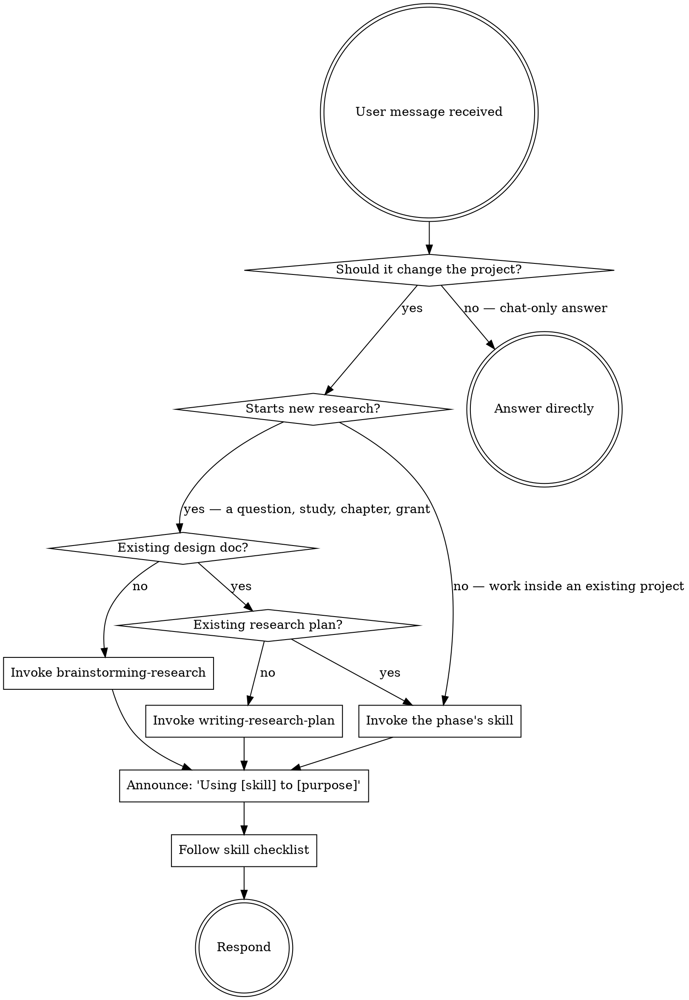

<SUBAGENT-STOP>
If you were dispatched as a subagent to execute a specific task (ingest a source, run an analysis, review a manuscript), skip this skill and follow the task prompt.
</SUBAGENT-STOP>

## When a skill should fire

When a request falls into a research phase — idea, plan, literature work,
source acquisition, ingest, analysis, manuscript, review, wrap-up — invoke the
governing skill before you answer or edit. The skill carries what the phase
needs and a general answer lacks: the checklist, the preconditions, the audit
trail.

**The test is what the request leaves behind.** If it should change the project
— a source page, an entity, a bib entry, a plan, a synthesis, a draft, a
review — a skill governs it; use that skill. If the answer lives only in the
chat — a single reference, a definition, a date, what a wiki page says, an edit
the user dictates word for word — answer directly. A phase skill there is
ceremony, and it can steer the user into a workflow (a brainstorming session, a
plan) they did not ask for.

## Instruction Priority

User instructions always take precedence:

1. **User's explicit instructions** (CLAUDE.md, AGENTS.md, direct requests) — highest priority
2. **Research-superpowers skills** — override default system behavior where they conflict
3. **Default system prompt** — lowest priority

When the user says "skip brainstorming, just draft the chapter": follow the user, but name the skipped phase explicitly. The skill mechanism for these cases is the SOFT-GATE — it logs the decision to `knowledge/_meta/gate-overrides.log` rather than blocking.

## The Research Workflow

Research projects move through phases. Each phase has a governing skill. Phases are gated — later phases cannot proceed without the artifacts the earlier phases produce.

```
brainstorming-research     → input/ideas/<slug>-design.md (SOFT-GATE: design approval)
writing-research-plan      → input/ideas/<slug>-plan.md
                              (SOFT-GATE: pre-registration only for methodology=quantitative/mixed;
                                          for hermeneutic, status=ready is enough)
literature-review          → input/bibliography/*, output/bibtex/references.bib (search only — no downloads)
acquire-sources            → <library>/pdf/*.pdf, input/bibliography/acquisition-todo.md
                              (auto-download OA; manual worklist for paywalled; re-run to reconcile)
ingest-source (loop)       → knowledge/sources/*, knowledge/entities/*
                              (HARD-STOP on a missing original — no silent preprint/review substitution)
executing-research-plan    → output/data-analysis/*, knowledge/synthesis/*
                              (runs an acquisition gate before ingest tasks — invokes
                               acquire-sources automatically inside a plan run, not only interactively)
drafting-manuscript        → output/**/*.qmd (SOFT-GATE: ≥1 stable synthesis + lint green)
requesting-peer-review     → review documents + revisions
finishing-a-research-project → rendered publication, archived data, grant follow-up
```

The phase graph is iterative, not linear. Legitimate back-edges:
`ingest-source` ↔ `writing-research-plan` (new reading revises the
hypothesis), `executing-research-plan` ↔ `drafting-manuscript` (an analysis
gap surfaced while writing). See `docs/phase-flow.md`.

Support skills are context-triggered, not phase-bound:

- **scaffold-research-project** — when the working directory is not yet a research project
- **add-to-library** — when adding one PDF straight to the shared library (verify + keyword it), outside the project ingest flow
- **wiki-lint** — before drafting, before finishing, after bulk ingest
- **semantic-wiki-review** — when the wiki's *content* needs auditing: contradictions, claims overtaken by newer sources
- **wiki-graph** — to analyse the wiki's structure (god nodes, bridges, clusters) and export it as a graph
- **drift-report** — to check library and projects for accumulated drift (also runs at session start)
- **grant-finder** — when planning funding in parallel to publication

Two things are deliberately **not** skills of this plugin:

- **Critical evaluation** of evidence and method is a checklist inside
  `executing-research-plan` (method selection) and `requesting-peer-review`
  (evidence audit), not a separate skill.
- **Format utilities** — OCR, geodata, image processing, file conversion — come
  from the host, if installed. For scans, `ocrmypdf` is the tool the drift
  report and `bib-search` already name.

## Routing



"Starts new research" means opening a question, study, chapter or grant. Finding
literature for a running project, ingesting one more source or revising a
section does not — those go straight to their phase skill.

## Red Flags

Thoughts that, in this plugin's domain, come right before the failures it exists
to prevent — a claim no source backs, a draft written from memory, a review that
never happened:

| Thought | Reality |
|---------|---------|
| "The source is short, I'll skim it" | Ingest requires structured extraction. |
| "I know what the source says" | Knowing ≠ documented. Ingest the source. |
| "I'll just freewrite the draft" | Drafts pull from synthesis pages, not from memory. |
| "I have the hypothesis in my head" | Quantitative: written in the plan. Hermeneutic: research question + method sketch is enough. |
| "I'll clean up the wiki later" | Lint before draft — overrides get logged. |
| "Peer review is optional" | Not before publication, it isn't. |
| "This new project doesn't need a design doc" | Brainstorming first. The user may skip it — then name the skipped phase and log the reason (SOFT-GATE). |

## Skill Priority (multiple skills could apply)

1. **Phase skills first** (brainstorming-research, writing-research-plan, literature-review, acquire-sources, ingest-source, executing-research-plan, drafting-manuscript, requesting-peer-review, finishing-a-research-project) — these determine WHERE in the workflow you are
2. **Support skills second** (wiki-lint, semantic-wiki-review, wiki-graph, drift-report, add-to-library, grant-finder) — these refine HOW you do a step
3. **Host utilities last** (OCR, file conversion, …) — these handle format questions

Trigger examples:

- "Let's do research on X" → **brainstorming-research**
- "I have an idea/sketch" → **brainstorming-research**
- "Write a plan for the project" → **writing-research-plan** (if design doc exists) or **brainstorming-research** first
- "Find literature on X" → **literature-review**
- "Get / download the PDFs", "Quellen beschaffen" → **acquire-sources**
- "Ingest this source" → **ingest-source**
- "Add this PDF straight to the library", "in die Bibliothek aufnehmen" → **add-to-library**
- "Analyze the data" → **executing-research-plan** (if plan exists) else **writing-research-plan** first
- "Write the chapter" → **drafting-manuscript** (if synthesis pages stable) else back to synthesis
- "Review the manuscript" → **requesting-peer-review**
- "Find funding" → **grant-finder**
- "Show me a knowledge graph / which entity bridges my sources / most-connected pages" → **wiki-graph**
- "Who wrote X, and when?" / "What does our page on Tel Rehov say?" → **no skill** — answer directly

## Skill Types

**Rigid** (must follow the checklist exactly, do not skip steps):
- scaffold-research-project, brainstorming-research, writing-research-plan, acquire-sources, ingest-source, add-to-library, executing-research-plan, drafting-manuscript, finishing-a-research-project

**Flexible** (adapt principles to context):
- literature-review, requesting-peer-review, grant-finder, wiki-lint, semantic-wiki-review, wiki-graph, drift-report

The skill itself tells you which.

## How to Access Skills

**In Claude Code:** Use the `Skill` tool. The skill content is presented to you — follow it. Never `Read` a skill file in place of invoking it.

**In OpenCode:** Skills load natively from `skills/<name>/SKILL.md` and `.claude/skills/<name>/SKILL.md`. Trigger them via natural language or the built-in `skill` tool (e.g. `skill({ name: "ingest-source" })`).

**"Task-list item"** in a checklist means whatever task tracker the host gives you: `TaskCreate` / `TaskUpdate` in current Claude Code, `TodoWrite` in older Claude Code builds and in OpenCode. The skills name the concept, not the tool, so they survive a rename.

## The Research Project Template

Every research project uses the same folder layout (from `templates/research-project-template/`):

```
project-root/
├── input/       # human-authored: bibliography, data, notes, ideas (design & plan docs live here)
├── knowledge/   # LLM-generated wiki: entities, concepts, sources, synthesis
├── output/      # publishable artifacts: publication (Quarto), data-analysis, bibtex
└── scripts/     # lint-wiki.py, wiki-to-graph.py, library.py, bib-subset.py, bib-search.py
```

If the working directory is not yet a research project, the first skill invocation should offer to scaffold it from the template.

**The source PDFs are not in the repo.** They live once, centrally, in the shared library — `<library>/pdf/<bibkey>.pdf`, where the filename *is* the citekey. The library path is machine-local: `scripts/library.py` resolves it (`RESEARCH_LIBRARY` → `.research-library` → `~/.config/research-superpowers/library`), so never hard-code it. Two scripts read it:

```bash
python scripts/bib-subset.py                        # output/bibtex/references.bib ← the library
python scripts/bib-search.py index                  # build the full-text index (once, then incremental)
python scripts/bib-search.py "copper smelting"      # → bibkey · physical PDF page · snippet
```

`bib-search` answers "*where* does anyone say this?" across every project's sources at once, and returns the page to open. It is the entry point for `drafting-manuscript`'s reach-back when a wiki page carries no page anchor.
